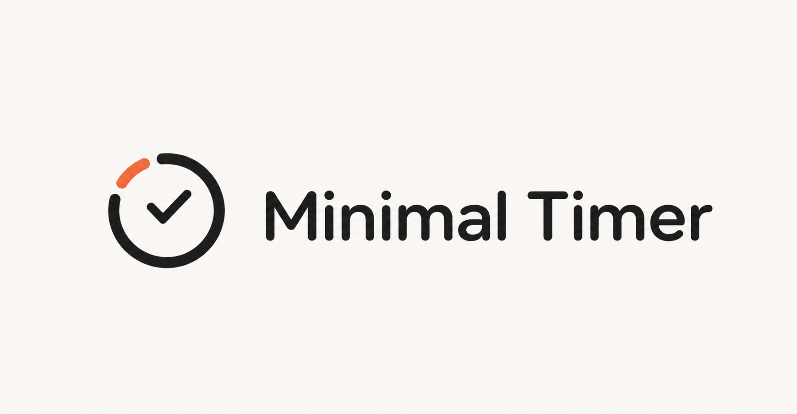
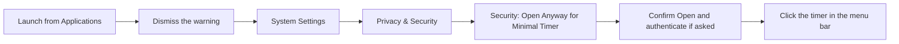

<p align="center">
  
</p>

# Minimal Timer

**A tiny macOS menu-bar timer for doing one thing at a time.**

Minimal Timer keeps activity tracking and Pomodoro sessions pleasantly out of
your way. Name what you are doing, start the clock, and get back to it. When
you are done, finish the activity and let the app keep the total. No accounts,
no subscriptions, no surprise upgrade screen—just a small timer that lives
where you already look.

**[Download for Mac](https://github.com/marandicimihai/timer-app/releases/latest/download/MinimalTimer.dmg)** · macOS 14+ · Apple Silicon and Intel

Free, no account required. This release is not Apple-notarized; see the first-launch instructions below.

If you find it useful, a GitHub star helps others discover the project.

## Why it feels good to use

- **One click away.** It lives in the menu bar, not in another busy window.
- **Activities without admin.** Start “Writing,” “Email,” or “Deep work”; the
  elapsed time is visible at a glance. Switch tasks or finish when you are
  ready.
- **A Pomodoro timer that does not make a scene.** Start a focus or break
  session, see its progress, and receive a notification when it ends.
- **A little history, not a dashboard.** Review completed activities and daily
  totals when you need a reality check. Delete individual entries or clear the
  history whenever you like.
- **Your defaults, your way.** Adjust focus and break lengths, toggle
  notifications, and choose which timer details appear in the menu bar.
- **Private by default.** Activity history stays on this Mac. Nothing is sent
  anywhere.
- **Actually free.** No fees, trials, ads, or artificial limits.

## Install

1. **[Download Minimal Timer](https://github.com/marandicimihai/timer-app/releases/latest/download/MinimalTimer.dmg)** and double-click the disk image.
2. Drag **Minimal Timer.app** onto **Applications** in the disk image.
3. Open **Minimal Timer** from Applications, then eject the disk image.
4. Look for its timer icon in the menu bar. There is intentionally no Dock icon.

If macOS blocks the first launch, follow **A quick security heads-up** below.
No Terminal, Homebrew, or developer tools are required.

Prefer a ZIP? The versioned ZIP is available on the
[Releases page](https://github.com/marandicimihai/timer-app/releases/latest).

Minimal Timer requires **macOS 14 or later**. Click the menu-bar icon, name an
activity, and press **Start**. For a focus session, use the Pomodoro controls
in the same little popover.

Hold **Option-T** anywhere to open a wheel with up to four activities.
Move toward an activity and release **T** to start it, or tap **Option-T**
and flick toward it. The running activity appears at the top with a **Stop**
label; select it to finish the timer.

### A quick security heads-up

Minimal Timer is ad-hoc signed but is not yet Developer ID signed and notarized
by Apple. macOS may therefore show a warning the first time you open a
downloaded release. That warning is normal for the current build—but only
continue if you downloaded the app from this repository's official Release
page and trust it.

If macOS blocks the app:

1. Try opening **Minimal Timer** once, then dismiss the warning.
2. Go to **Apple menu → System Settings → Privacy & Security**.
3. Scroll to **Security**, click **Open Anyway**, and confirm **Open**.
4. Enter your Mac login password if asked.

The flow below is a navigation diagram, not a screenshot:



Approve only **Minimal Timer**. You do not need to disable Gatekeeper or change
which apps your Mac allows globally. On a managed Mac, your organization may
restrict this option; if it is missing, [report the exact warning](https://github.com/marandicimihai/timer-app/issues/new?template=feedback.yml).

macOS will remember that choice for this copy of the app. For more context on
the warning, see [Apple's guidance for opening an app from an unknown
developer](https://support.apple.com/102445).

## A small tour

| When you want to… | Do this |
| --- | --- |
| Track a task | Enter its name and choose **Start**. |
| Move to the next task | Finish the current activity, then start another. |
| Reuse something familiar | Choose an activity below the input. Activities appear newest first; scroll horizontally to see more. |
| Take a focused break from multitasking | Choose **Start Focus**. When it completes, start the suggested break (or the next focus session). |
| See where the day went | Open **History** for daily totals and completed activities. |
| Change the menu-bar display | Open **Settings** to show or hide the activity time. |
| Set a weekly goal | In **Goals**, enable an activity and enter its target hours. Progress appears below the menu-bar chart. |
| Manage activities | Open **Manage activities** to change colors, archive or unarchive activities, or delete them with their history. |
| Tune or disable Pomodoro | Open **Pomodoro** to change durations, alerts, its menu-bar icon, or turn Pomodoro off entirely. |

Weekly goals run Monday–Sunday in your local time zone and include time from a
running activity. Progress stays gray until the goal is complete, then turns
green. Percentages stop at 100%, and remaining time is shown until completion.
Targets stay saved between launches and can be edited or turned off in Goals.
Archived activities are hidden from Goals.

History shows the last 30 days first. Older entries are grouped by month and
loaded when you expand a month. Right-click an entry to delete it, or a day
heading to delete that day's entries. Deleting a day asks for confirmation and
preserves entries belonging to archived activities.

Archived activities keep their history, chart visibility, colors, and existing
goals. Their colors, goals, and history stay read-only until you unarchive them.
You can explicitly delete an archived or unarchived activity from **Manage
activities**. After confirmation, this removes all its history, weekly goal,
custom color, and archive status. Finish a running activity before deleting it.
Starting an activity with the same name (ignoring case and surrounding spaces)
automatically unarchives it. Turning off Pomodoro stops its timer and removes
its controls and icon from the menu bar.

## Feedback

[Report install trouble or share feedback](https://github.com/marandicimihai/timer-app/issues/new?template=feedback.yml). Tell us what you used it for, whether you came back, and what would make it more useful.

## Your data

Minimal Timer stores completed activity history locally at
`~/Library/Application Support/MinimalTimer/activity-history.sqlite`. It stays
on your Mac; clearing history removes entries for unarchived activities while
preserving archived activity history.

## Build a release locally

Run `./scripts/bundle-release.sh`, then:

```sh
./scripts/package-dmg.sh dist/MinimalTimer-1.10.0.zip
./scripts/verify-release.sh dist/MinimalTimer.dmg
```

Use the version in `Packaging/Info.plist` when the version changes. The scripts
produce a universal app, a versioned ZIP, `MinimalTimer.dmg`, and SHA-256 files
in `dist/`. The DMG includes an Applications shortcut and first-launch instructions.
No Apple membership, notarization service, or hosting is required.

Attach the DMG and its checksum to the corresponding GitHub release, alongside
the ZIP and its checksum. Keep the exact asset name `MinimalTimer.dmg` so the
Download for Mac link works. For an existing release, package its published ZIP
instead of replacing it with a fresh build. See [release verification](docs/release-checklist.md).
